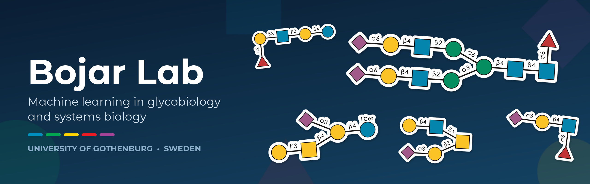
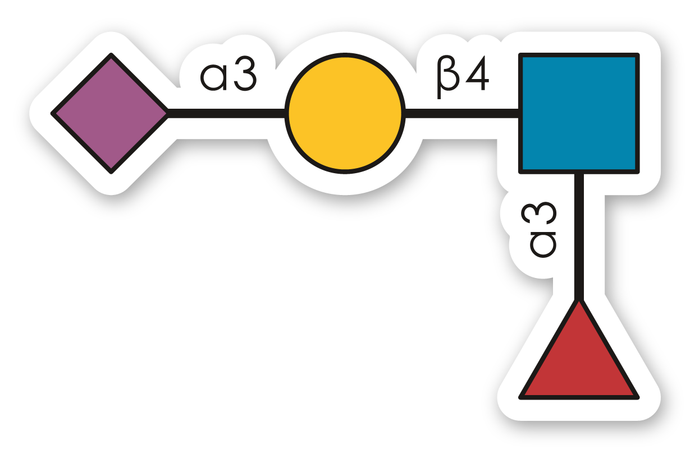

<p align="center">
  
</p>

We build computational tools to read, analyze, and predict glycans: the complex, branched carbohydrates that coat every cell and shape infection, immunity, cancer, and development. Our software is open source, Python-first, and designed to work together, with [glycowork](https://github.com/BojarLab/glycowork) as the shared foundation.

[Lab website](https://dbojar.com/bojar-lab/) · [X: @daniel_bojar](https://x.com/daniel_bojar)

---

## Core packages

| Package | What it does | Install |
| --- | --- | --- |
| [**glycowork**](https://github.com/BojarLab/glycowork) | The hub: glycan sequence processing, motif analysis, glycomics statistics, biosynthetic networks, deep learning models, and GlycoDraw drawing. [Docs](https://bojarlab.github.io/glycowork) | [](https://pypi.org/project/glycowork/) |
| [**CandyCrunch**](https://github.com/BojarLab/CandyCrunch) | Predicts glycan structures from LC-MS/MS glycomics data with deep learning. | [](https://pypi.org/project/candycrunch/) |
| [**GlyContact**](https://github.com/BojarLab/glycontact) | Retrieves, processes, and analyzes 3D glycan structures. [Docs](https://bojarlab.github.io/glycontact/) | [](https://pypi.org/project/glycontact/) |
| [**GlycoForge**](https://github.com/BojarLab/GlycoForge) | Simulates glycomics datasets with controllable biological effects, batch effects, and missing data. | [](https://pypi.org/project/glycoforge/) |
| [**GlycoGym**](https://github.com/BojarLab/GlycoGym) | Benchmark suite of seven glycan property prediction tasks, plus the GlyVerse pre-training corpus. | [](https://pypi.org/project/glycogym/) |
| [**glycorender**](https://github.com/BojarLab/glycorender) | Renders GlycoDraw SVGs to publication-ready PDF and PNG. | [](https://pypi.org/project/glycorender/) |

Draw any glycan in SNFG notation with one line of glycowork:

```python
# pip install glycowork
from glycowork.motif.draw import GlycoDraw

GlycoDraw("Neu5Ac(a2-3)Gal(b1-4)[Fuc(a1-3)]GlcNAc", sticker=True)  # sialyl Lewis X
```

<p align="center">
  
</p>

All banner art on this page is drawn the same way; see [scripts](https://github.com/BojarLab/.github/tree/main/scripts).

## Apps and community

- [**Canonicalize**](https://canonicalize.streamlit.app/): convert glycan sequences from any common notation to canonical IUPAC-condensed in the browser ([code](https://github.com/BojarLab/canonicalize_app)).
- [**GlycoGauntlet**](https://github.com/BojarLab/GlycoGauntlet): an open competition to annotate LC-MS/MS glycomics data. Beat CandyCrunch or bring your expert annotations, and join the paper.

## Research code

Analysis code and data accompanying our publications:

- [Reaction-order](https://github.com/BojarLab/Reaction-order): preferred reaction order from diamond motifs in biosynthetic networks
- [FragmentFactory](https://github.com/BojarLab/FragmentFactory): human-interpretable diagnostic glycan fragments
- [LectinOracle_MIMB](https://github.com/BojarLab/LectinOracle_MIMB): the LectinOracle chapter in *Methods in Molecular Biology*
- [scGlycomics_b16_branching](https://github.com/BojarLab/scGlycomics_b16_branching): predicting single-cell glycosylation features from scRNA-seq

Earlier models such as [SweetNet](https://github.com/BojarLab/SweetNet), [LectinOracle](https://github.com/BojarLab/LectinOracle), and [GIFFLAR](https://github.com/BojarLab/GIFFLAR) are archived; their maintained implementations live in glycowork.

## Teaching

Computer labs for the course BIO513: [glycomics](https://github.com/BojarLab/bio513_modules), [proteomics](https://github.com/BojarLab/Bio513_proteomics), and [metabolomics](https://github.com/BojarLab/Bio513_metabolomics).

## Get involved

Found a bug or missing feature? Open an issue in the relevant repository. Contributions are welcome, and new functionality usually fits best as an extension of glycowork or CandyCrunch rather than a standalone tool.
